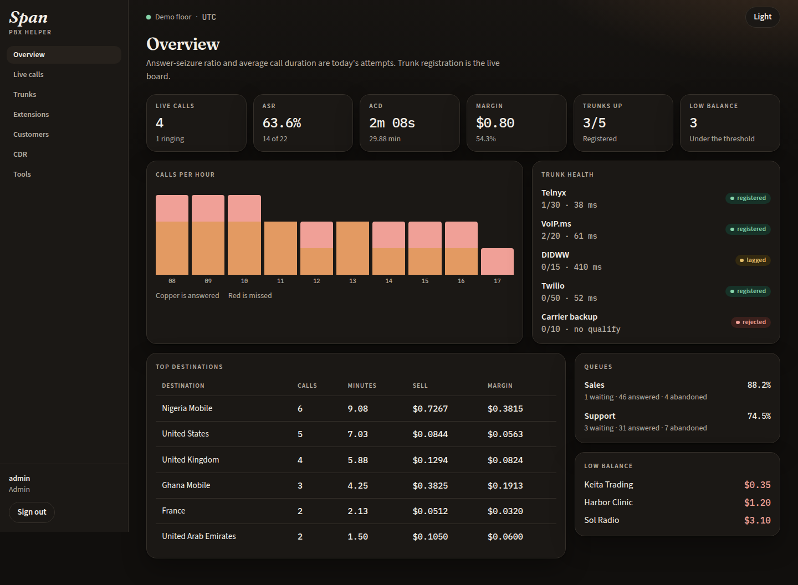
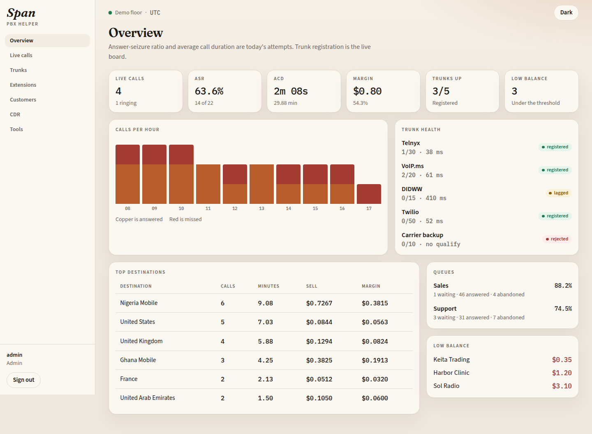
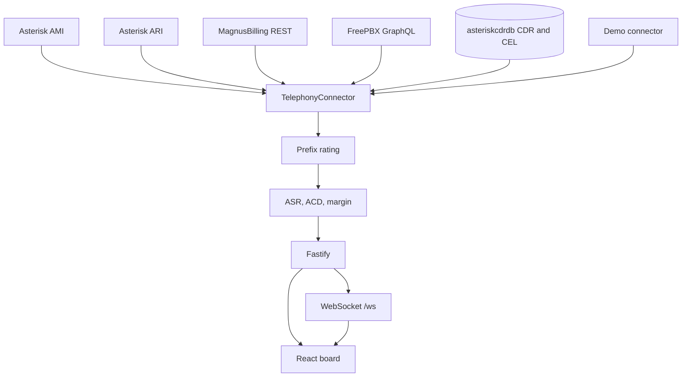
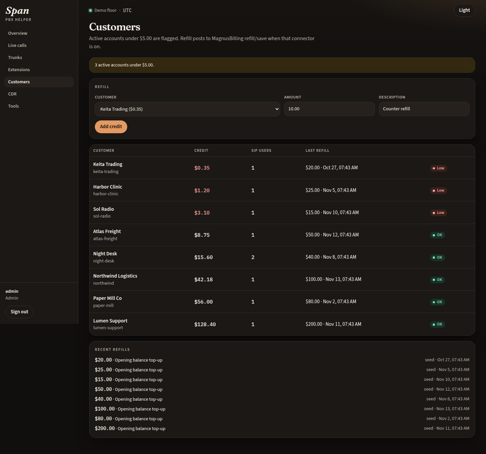
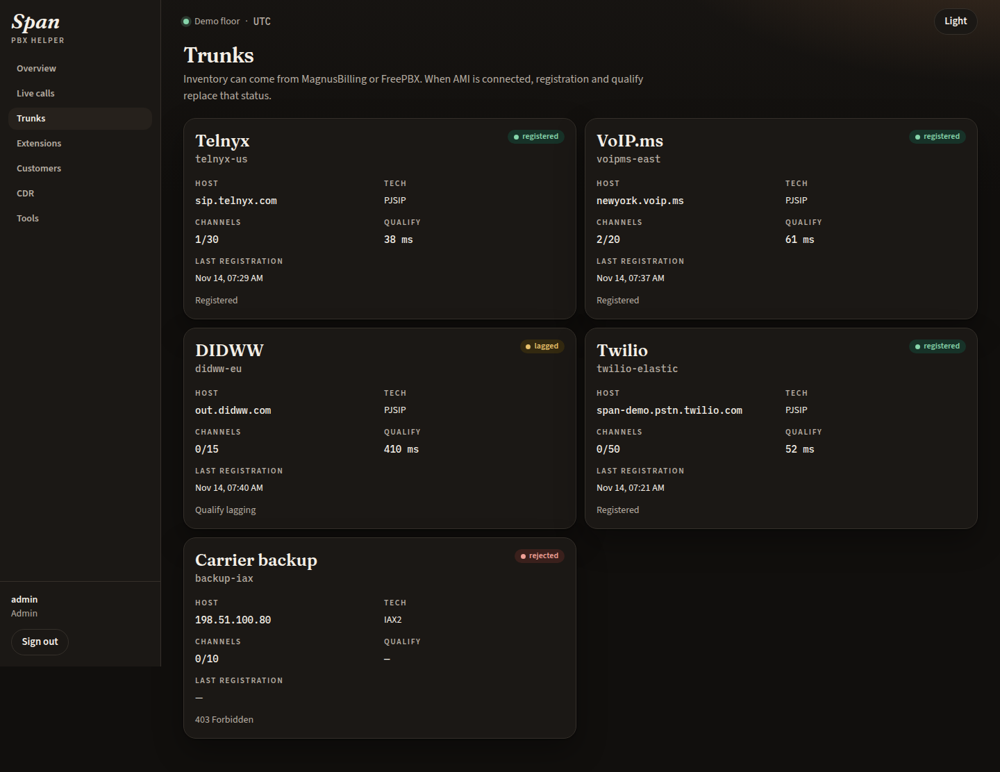

# Span

[](https://github.com/maikama8/pbx-helper-dashboard/actions/workflows/ci.yml)

A billing desk and a PBX rarely agree on what is happening right now. Span is one board for both: who is on a channel, which trunk is actually registered, which MagnusBilling customer is about to run out of credit, and what today's attempts cost against the rate you bought.

It is a portfolio project. The default connector is a seeded demo, so the API, the tests, the UI, and Docker start with no PBX and no billing server. Live mode speaks Asterisk AMI, ARI for hangup, the MagnusBilling REST API, FreePBX GraphQL, and a read-only MySQL user on `asteriskcdrdb`.





The screenshots are the opening scene, taken with `SIM_TICK_MS=0` so a tick does not move a call while the picture is taken. Four channels are up, one of them still ringing. ASR is 63.6% on 22 attempts, ACD is 2m 08s, three of five trunks are registered, and three customers are under the $5 line. Nothing in those pictures was drawn by hand: it is the state the process serves.

## Features

- Overview: live calls, answer-seizure ratio, average call duration, calls per hour, top destinations, trunk health, queue stats, low-balance alerts.
- Live calls with a hangup action. ARI when it is configured, AMI `Hangup` otherwise. The viewer role cannot press it.
- Trunks and registration, from Magnus or FreePBX inventory, with AMI qualify and registry status laid on top.
- Extensions and SIP users, FreePBX and Magnus on one list, peer status when AMI knows the name.
- Customers, a low-balance threshold, and a refill form that posts `refill/save` on Magnus.
- CDR explorer: filters, the same analytics on the filtered set, CSV export, cost and margin, and recent CEL.
- Tools that only print text: a SIP trunk snippet for Telnyx, Twilio, VoIP.ms, DIDWW, or a custom host; a dialplan snippet; a fail2ban and exposure checklist; codec and NAT notes.
- Demo mode with a seeded day and a small live tick over WebSocket.
- Admin and read-only logins. Session cookie. Docker Compose, plus an optional Asterisk lab container.

## Tech stack

Node 22, [Fastify](https://fastify.dev/) 5, and a React 19 UI built with Vite and Tailwind.

A helper like this holds a long-lived AMI socket and fans snapshots out to browsers. That wants one process, not a serverless function per request, so the UI is a static bundle served by the same Fastify server that owns the connectors. Next.js would split the socket, the session, and the pages across a different runtime for no gain here. The shape matches the wallboard in [voip-call-center-dashboard-modern](https://github.com/maikama8/voip-call-center-dashboard-modern): a connector interface, pure billing math, and a board that does not know which side produced the rows.

Tests are Vitest. Lint is ESLint.

## Architecture



Both connectors implement the same surface: calls, trunks, extensions, queues, customers, refills, rates, CDRs, CEL, hangup, refill. Routes and the socket only see that surface. Rating and the ratios are pure functions of the rows, so the demo day and a MySQL row go through one formula.

Hangup and refill are the only writes. The SIP and dialplan tools return text. They do not reload Asterisk.

## Getting started

Requires Node.js 22.

```bash
git clone https://github.com/maikama8/pbx-helper-dashboard.git
cd pbx-helper-dashboard
npm install
cp .env.example .env
npm run dev
```

- Board, with the API proxied: `http://127.0.0.1:5173`
- API: `http://127.0.0.1:8080`
- Health: `http://127.0.0.1:8080/api/health`

Sign in as `admin` / `span-demo-admin`, or as `viewer` / `span-demo-viewer` if you want the buttons disabled. Those passwords are in `.env.example` and on the sign-in card so a checkout is usable. Change them before the port is reachable from anywhere else.

`npm run dev` starts the API and Vite together. `make dev`, `make test`, `make lint`, `make typecheck`, and `make build` wrap the same scripts.

To serve the built UI from the API:

```bash
npm run build
npm start
```

The board is then at `http://127.0.0.1:8080`.

### Docker

```bash
docker compose up --build
```

The image listens on port 8080 and defaults to the demo source. Compose supplies the demo passwords and a demo session secret when the shell has not set them. Change those for any host that is not your laptop.

An optional Asterisk 20 container is behind the `lab` profile. It is not started by `docker compose up`, and it binds AMI to `127.0.0.1:5038` only.

```bash
docker compose --profile lab up --build
```

The lab manager secret is `span-lab-ami` in [deploy/asterisk/manager.conf](deploy/asterisk/manager.conf). It is a local experiment, not a production user.

## Live connectors

Set `SOURCE=live` and fill in the connectors you actually have. At least one of AMI, Magnus, FreePBX, or CDR MySQL is required, or the process refuses to start. A connector that is configured and then fails does not take the board down: `/api/health` becomes `degraded` and the warning stays on the overview.

| System | What Span reads | What Span writes | Setup |
| --- | --- | --- | --- |
| Asterisk AMI | Channels, peers, registry, queues | `Hangup`, and only if ARI is not configured | [docs/asterisk-ami.md](docs/asterisk-ami.md) |
| Asterisk ARI | Nothing | `DELETE` the channel | [docs/asterisk-ami.md](docs/asterisk-ami.md) |
| MagnusBilling | Customers, SIP users, trunks, rates, CDRs | `refill/save` | [docs/magnusbilling.md](docs/magnusbilling.md) |
| FreePBX GraphQL | Extensions and trunks | Nothing | [docs/freepbx.md](docs/freepbx.md) |
| `asteriskcdrdb` | `cdr` and `cel`, `SELECT` only | Nothing | [docs/freepbx.md](docs/freepbx.md) |

AMI registration replaces the status on a trunk whose name matches. Magnus remains the billing source when both Magnus CDR and MySQL are configured, because Magnus has the price and MySQL has the channel events.

## Configuration

Settings are read from the environment and from a `.env` file in the repo root. Existing environment variables win. See [.env.example](.env.example).

| Variable | Default | Purpose |
| --- | --- | --- |
| `SOURCE` | `demo` | `demo` or `live` |
| `HOST` | `0.0.0.0` | Bind address |
| `PORT` | `8080` | HTTP and WebSocket |
| `TIMEZONE` | `UTC` | IANA zone for "today" and the hour chart |
| `LOG_LEVEL` | `info` | Fastify log level |
| `WEB_DIST` | `web/dist` if present | Built UI. Empty skips static files |
| `SESSION_SECRET` | a demo value | HMAC key for the session cookie |
| `ADMIN_USERNAME` / `ADMIN_PASSWORD` | `admin` / `span-demo-admin` | May hang up and refill |
| `VIEWER_USERNAME` / `VIEWER_PASSWORD` | `viewer` / `span-demo-viewer` | Read only |
| `COOKIE_SECURE` | `0` | Set `1` behind HTTPS |
| `LOW_BALANCE` | `5` | Customers under this are flagged |
| `SIM_TICK_MS` | `1500` | Demo tick. `0` freezes the floor. Otherwise at least 200 |
| `SIM_SEED` | `20261114` | Demo RNG. The opening rows do not depend on it |
| `AMI_HOST`, `AMI_PORT`, `AMI_USERNAME`, `AMI_SECRET` | empty | AMI is off until host and secret are both set |
| `AMI_RECONNECT_MS` | `5000` | Pause before the next TCP attempt |
| `ARI_URL`, `ARI_USERNAME`, `ARI_PASSWORD` | empty | Optional hangup path |
| `MAGNUS_URL`, `MAGNUS_API_KEY`, `MAGNUS_API_SECRET` | empty | All three, or none |
| `FREEPBX_GRAPHQL_URL`, `FREEPBX_TOKEN` | empty | Both, or none |
| `CDR_HOST`, `CDR_PORT`, `CDR_USER`, `CDR_PASSWORD`, `CDR_DATABASE` | host empty, database `asteriskcdrdb` | Read-only CDR user |

`SOURCE=live` with a demo session secret and `NODE_ENV=production` refuses to boot. An unknown `SOURCE` or a timezone that is not an IANA name does the same.

## How the numbers are computed

The opening day is 22 attempts, stamped on today's date in `TIMEZONE`. Fourteen were answered. The figures below are that day, in UTC, with the ticker frozen.

**Offered** is every attempt: answered, no answer, busy, failed, and congestion.

**ASR** = answered ÷ offered × 100, to one decimal. 14 ÷ 22 = **63.6%**. A failed setup stays in the denominator. That is the strict reading of seizure. Null when nothing was offered, and the board shows an em dash.

**ACD** is the mean `billsec` of answered calls, to one decimal. The answered billsec sums to 1793 seconds. 1793 ÷ 14 = **128.1 seconds** (2m 08s on the board).

**Minutes** are answered billsec ÷ 60, to two decimals: **29.88**.

**Rating** is per second: `billsec / 60 × rate`, kept to six decimal places. The prefix match is the longest prefix whose `minLength` the dialed number actually reaches. Extension `1003` is not sold as the United States just because it starts with `1`. A call to another extension is destination `Internal` and costs nothing. Missed attempts keep the destination and contribute zero money.

The opening tariff, per minute:

| Prefix | Destination | Buy | Sell |
| --- | --- | --- | --- |
| 234 | Nigeria Mobile | 0.038 | 0.080 |
| 233 | Ghana Mobile | 0.045 | 0.090 |
| 44 | United Kingdom | 0.008 | 0.022 |
| 33 | France | 0.009 | 0.024 |
| 1 | United States | 0.004 | 0.012 |
| 971 | United Arab Emirates | 0.030 | 0.070 |

**Sell** on the opening day is **1.479199**. **Buy** is **0.675817**. **Margin** is **0.803382**, which is **54.3%** of sell. The KPI rounds money to cents, so the board shows $0.80. The destination table keeps four decimal places.

Nigeria is the top destination: 6 attempts, 9.08 answered minutes, sell 0.726666. The United States is next by minutes (7.03) even though Ghana earns more (sell 0.3825) because the Ghana rate is higher. The chart's 08:00 bucket is two answered and one missed. 17:00 is a single failed attempt to the UAE.

**Low balance** is an active customer under `LOW_BALANCE` (5.00). The opening three are Keita Trading at 0.35, Harbor Clinic at 1.20, and Sol Radio at 3.10.



The refill form posts `refill/save` when Magnus is connected. In the demo it adds the credit in memory. The viewer role sees the form and cannot submit it.

**Trunks up** counts `registered` only. DIDWW is lagged at 410 ms and the backup carrier is rejected with `403 Forbidden`, so the board shows 3/5.



Queue service level is Asterisk's `ServicelevelPerf`, labelled as the PBX reported it. It is not the ASR above. Sales opens at 88.2% with one caller waiting. Support opens at 74.5% with three waiting.

A hangup of a call that was answered writes a CDR from `answeredAt`. The opening Nigeria channel has been up for 252 seconds and rates at sell 0.336 if you hang it up on the frozen clock. A call that never answered is `NO ANSWER` with zero cost.

## API

All `/api` routes except health and login require the session cookie. Mutations require the admin role and answer `403` with `read_only` for the viewer.

### `GET /api/health`

```bash
curl -s http://127.0.0.1:8080/api/health
```

```json
{
  "status": "ok",
  "source": "demo",
  "timezone": "UTC",
  "liveCalls": 4,
  "trunks": 5,
  "trunksUp": 3,
  "customers": 8,
  "lowBalance": 3,
  "warnings": []
}
```

`status` is `degraded` when a live connector's last refresh failed. The process is still serving the last good rows.

### `POST /api/login` and `POST /api/logout`

```bash
curl -s -c /tmp/span.cj -X POST http://127.0.0.1:8080/api/login \
  -H 'content-type: application/json' \
  -d '{"username":"admin","password":"span-demo-admin"}'
```

The cookie is `span.sid`, HttpOnly, SameSite=Lax, twelve hours. Eight failures from one address in ten minutes return `429`.

### `GET /api/snapshot` and `GET /ws`

The snapshot is the document the board paints: overview, calls, trunks, extensions, queues. The socket sends one on connect and another after every demo tick or AMI event. Customers, CDRs, and tools stay on their own routes.

### `POST /api/calls/:id/hangup`

Admin only. `404` if the channel is already gone. `409` in live mode when neither AMI nor ARI is configured. `502` when the PBX refuses.

### `POST /api/customers/:id/refill`

```bash
curl -s -b /tmp/span.cj -X POST http://127.0.0.1:8080/api/customers/2/refill \
  -H 'content-type: application/json' \
  -d '{"amount":10,"description":"cash desk"}'
```

Amount is from 0.01 to 100000 with at most two decimal places. Harbor Clinic opens at 1.20, so this returns credit 11.20 and the account leaves the low-balance list. In live mode this calls Magnus `refill/save` and then re-reads the customer.

### `GET /api/cdr` and `GET /api/cdr/export`

Filters: `from`, `to` (`YYYY-MM-DD` in `TIMEZONE`), `account`, `disposition`, `destination`, `q`. The JSON includes the analytics for the filtered rows, not only the page, plus recent CEL. Export is `text/csv` for the same filter, capped at 5000 rows. The viewer may export. Export does not change anything.

### Tools

`GET /api/tools/providers`, `POST /api/tools/sip`, `POST /api/tools/dialplan`, `GET /api/tools/checklist`, `GET /api/tools/nat`.

Trunk names, hosts, DIDs, and extensions are restricted to a token or a digit string so a value cannot close a section and open another. The password is checked for length and for line breaks, then placed in the snippet you asked for. It is not logged. The checklist is things to look at on a PBX you administer. It does not scan a host.

## Project structure

```
pbx-helper-dashboard/
├── server/src/
│   ├── index.ts                      # listens
│   ├── app.ts                        # Fastify, session, /api, /ws, static UI
│   ├── config.ts
│   ├── auth.ts                       # HMAC cookie, login limiter
│   ├── snapshot.ts                   # rows to the wire document
│   ├── domain/
│   │   ├── analytics.ts              # ASR, ACD, hours, destinations, filters
│   │   ├── rating.ts                 # longest prefix, per-second money
│   │   └── csv.ts
│   ├── connectors/
│   │   ├── demo/                     # opening day and the ticker
│   │   ├── ami/                      # frame parser, session, reducer
│   │   ├── ari/                      # DELETE /ari/channels
│   │   ├── magnus/                   # signed REST client
│   │   ├── freepbx/                  # GraphQL
│   │   ├── cdr/                      # parameterised CDR and CEL SQL
│   │   └── live.ts                   # wires the clients, reconnects AMI
│   └── tools/                        # SIP, dialplan, checklist, NAT notes
├── web/                              # React board
├── docs/                             # AMI, Magnus, FreePBX, screenshots
├── deploy/asterisk/                  # optional lab manager.conf
├── Dockerfile
└── docker-compose.yml
```

## Testing

```bash
npm run lint
npm run typecheck
npm test
npm run build
```

GitHub Actions (`.github/workflows/ci.yml`) runs those four on Node 22 for pushes to `main` and for pull requests.

The suite covers the opening ASR, ACD, hour bucket, and Nigeria ranking; prefix rating, including the extension that must not match the United States; CSV quoting; the AMI frame parser and the channel reducer; the Magnus signature and a refill body that does not contain the secret; FreePBX mapping and a GraphQL error; ARI basic auth; parameterised CDR SQL; the demo hangup that rates 252 seconds at 0.336; login, the viewer `403`, refill validation, CSV export, and the login rate limit. No test dials a PBX or a billing server.

## Security

- Demo passwords and `SESSION_SECRET` are for a checkout. `SOURCE=live` in production refuses the demo session secret. Set `COOKIE_SECURE=1` behind HTTPS.
- The viewer role cannot hang up or refill. The tools do not write to the switch.
- AMI is cleartext. Permit the dashboard host only. `write=call` if hangup is required, and not `command` or `originate`. See [docs/asterisk-ami.md](docs/asterisk-ami.md).
- The Magnus API key can add credit. Keep it out of the image and out of git.
- The CDR user is `SELECT` on `asteriskcdrdb.cdr` and `asteriskcdrdb.cel` only.
- Login is limited to eight failures per address in ten minutes.
- Generated snippets reject newlines in names and passwords so a field cannot inject a second config section.
- The lab Asterisk profile binds `5038` to localhost and is off by default.

## Roadmap

- Page the Magnus `read` calls past the first few hundred rows.
- Keep the observed day across a restart, so an AMI reconnect does not drop the board. SQLite is enough.
- A CEL filter of its own, linked to the CDR `uniqueid`.
- Trunk failover notes: which route actually took the call, from `dstchannel`, next to the rate.
- OAuth in front of the session cookie for a shared NOC.
- A read-only Prometheus scrape of ASR, trunk state, and low-balance count.

## Author

**Abdulrasheed Oseni** ([@maikama8](https://github.com/maikama8)), Zarachtech — VoIP specialist in Asterisk, FreePBX, Vicidial, and MagnusBilling.

This repository is a public portfolio project.

## License

[MIT](LICENSE). Copyright (c) 2026 Abdulrasheed Oseni.
